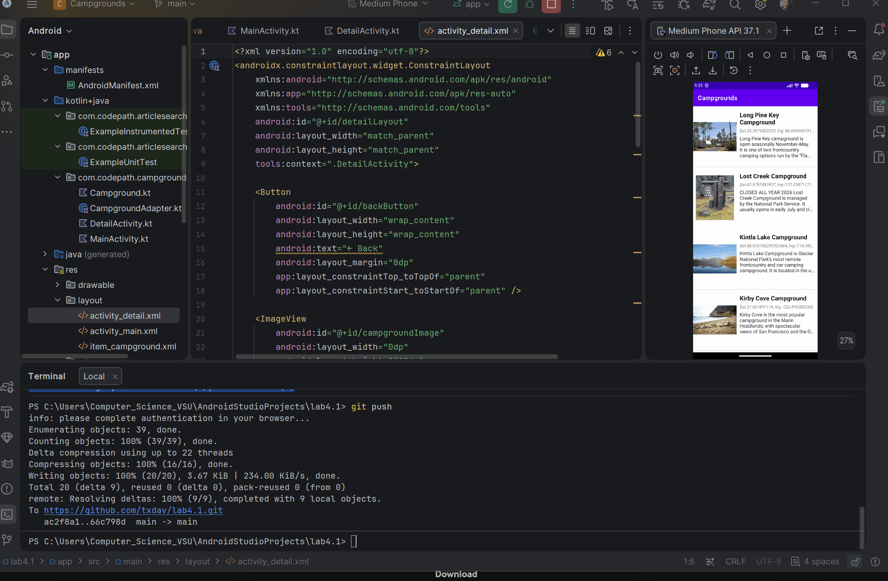

# Campground Explorer — Lab 4

## About the Project

Campground Explorer is an Android application built with Kotlin that retrieves campground information from the National Park Service (NPS) API. The application allows users to browse campground listings and view additional information about individual campgrounds.

This project focuses on API integration, RecyclerView, Android activities, and navigation between screens.

## Demo

## Features

- **Campground Listings:** Retrieve campground information from the National Park Service API.
- **RecyclerView:** Display campground information in a scrollable list.
- **Campground Details:** Open a dedicated detail screen to view information about a selected campground.
- **Activity Navigation:** Pass campground information between activities using Android intents.
- **API Integration:** Retrieve campground data from an external API.
- **Image Display:** Display campground images when image URLs are available.

## Technologies Used

- Kotlin
- Android Studio
- Android SDK
- RecyclerView
- Android Activities and Intents
- AsyncHttpClient
- National Park Service API
- XML Layouts

## API Integration

The application retrieves campground data from the National Park Service API.

**API endpoint:**

https://developer.nps.gov/api/v1/campgrounds

An API key is required to access the service. API credentials should be stored in local configuration and should not be committed to a public repository.

## Application Structure

The project uses several Kotlin files and XML layouts to organize the application:

- `MainActivity.kt` — Manages the main screen and campground listing.
- `Campground.kt` — Represents campground data retrieved from the API.
- `CampgroundAdapter.kt` — Binds campground information to RecyclerView items.
- `DetailActivity.kt` — Displays additional information about a selected campground.
- `activity_detail.xml` — Defines the layout for the campground detail screen.

## Implementation Challenges

During development, I worked through issues involving API connectivity, displaying campground information, and navigating between activities.

Troubleshooting these issues helped reinforce the importance of verifying network connectivity, correctly binding data to RecyclerView items, and passing information between Android activities.

## Getting Started

1. Clone or download the repository.
2. Open the project in Android Studio.
3. Configure the required National Park Service API key.
4. Allow Gradle to sync and build the project.
5. Run the application on an Android emulator or compatible Android device.
6. Connect to the internet to retrieve campground information.
7. Select a campground to explore its details.

## Project Goal

The goal of this project is to build an Android application that retrieves and presents campground information while practicing API requests, RecyclerView implementation, data handling, and navigation between activities.

---

**Project:** Campground Explorer — Lab 4
